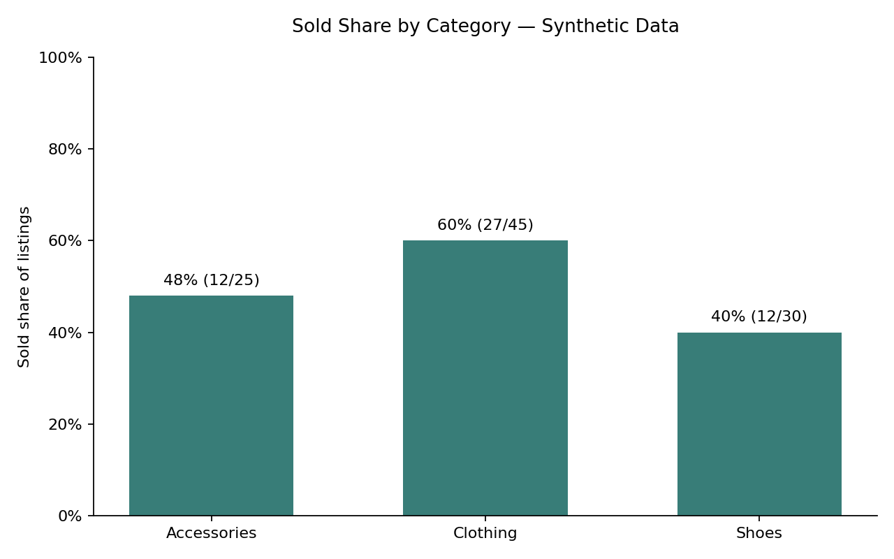

# Sell-through Rate by Category — Synthetic Demo

**Business question:** Which category has the highest share of listings marked sold in this demonstration dataset?

This beginner SQL and pandas project is a portfolio exercise supporting a Vinted Academy application. It uses a separate `demo_items` table with **100 synthetic listings**: 45 Clothing, 30 Shoes, and 25 Accessories. Each listing has a unique ID, a short title, a positive listed price in euros, and an `active`, `sold`, or `reserved` status. The original `users` and `items` examples are preserved.

The data is synthetic. Differences between categories are deliberately constructed for demonstration and do not represent real Vinted performance.

## Metric and results

**Sold percentage = 100 × listings with status `sold` / all listings in the category.**

The denominator includes `active`, `sold`, and `reserved`; only `sold` counts as a sale.

| Category | Total listings | Sold listings | Sold percentage |
| --- | ---: | ---: | ---: |
| Accessories | 25 | 12 | 48% |
| Clothing | 45 | 27 | 60% |
| Shoes | 30 | 12 | 40% |



- Clothing has the highest sold share: **60% (27/45)**, which is **20 percentage points** above Shoes at **40% (12/30)**.
- Accessories and Shoes each have **12 sold listings**, but Accessories has a higher sold share (**48% versus 40%**) because it has fewer total listings (**25 versus 30**).
- The **average listed price of sold items** is **€22.37** for Clothing, **€32.75** for Shoes, and **€17.58** for Accessories. These are listed prices; actual transaction amounts are unavailable.

## Files and running the analysis

The original `1_create_schema.sql` and `2_queries.sql` contain the existing PostgreSQL examples. The new demo is independent and does not require those examples to be run first.

1. In a PostgreSQL SQL editor, run `3_demo_items.sql` once to create and populate `demo_items` in your learning database.
2. Run the three queries in `4_sell_through_analysis.sql`: counts by category and status, sold share by category, and average listed price of sold items.
3. Export the **second query's** result as `sold_share_by_category.csv`, including column headers. A matching CSV is already included. Keep the columns `category,total_listings,sold_listings,sold_percentage`.
4. From the repository root, install the two Python dependencies and create the PNG:

```bash
python -m pip install pandas matplotlib
python sql_marketplace/plot_sold_share.py
```

The script reads the CSV and saves `sold_share_by_category.png` next to it. Python does not connect to the database.

## Validation

The dataset and all three queries were executed using SQLite, with SQL syntax also compatible with PostgreSQL. Checks confirmed exactly **100 rows**, **100 unique IDs**, positive prices, only the allowed categories and statuses, and all three statuses in every category. Category totals are **45 / 30 / 25** for Clothing / Shoes / Accessories. The CSV matches the second SQL query; the chart reads that CSV and the results above use the same values.

## Limitations

This is synthetic data with no listing dates or sale dates. The metric measures the sold share in a **single snapshot**, rather than 30-day sell-through. We cannot tell how quickly items sold or compare equal periods of exposure. The results cannot support conclusions about real Vinted buyers or category performance.
